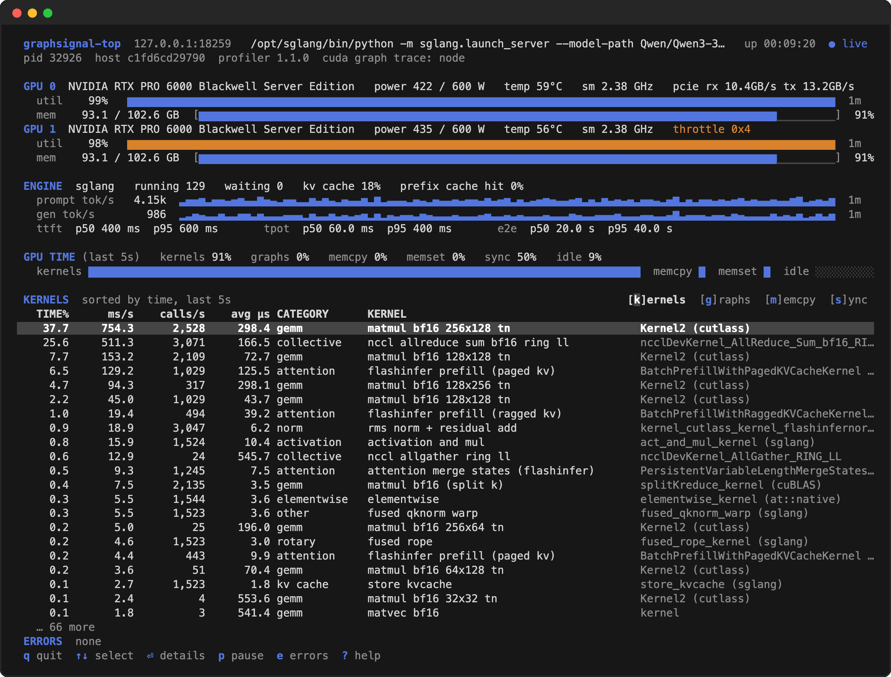

---

Graphsignal is a GPU profiler for AI agents to autonomously optimize inference performance across models, engines, and GPUs. It observes an inference engine or any GPU application from a sidecar process and exposes everything it measures through a local JSON API — everything an agent needs to profile, change flags or code, and measure again.

* GPU activity profiles via CUPTI/ROCm injection: cumulative time per kernel, per CUDA graph, and per memcpy/memset/synchronization kind, plus transfer byte counters.
* GPU probes: a vendorable C++ header to instrument code and kernels — by hand, or by an agent.
* GPU telemetry via NVML: utilization, memory, power, clocks, throttling, NVLink/PCIe throughput, XID errors.
* Process and host metrics: CPU, memory, command lines, runtimes.
* Inference engine metrics imported from Prometheus endpoints (vLLM, SGLang, TensorRT-LLM).
* Error capture from engine console output, including crashes and tracebacks.
* Local `/signals` HTTP endpoint serving metric statistics, recent errors, and resources as JSON.

The profiler runs entirely locally: it listens on `127.0.0.1` (unless you bind it elsewhere with `--listen-host`) and sends no profiling data anywhere else unless you opt into the [production feedback loop](#production-feedback-loop).


## Installation

The default way to start is to give the profiler's skill to an AI agent — the skill is self-contained, so the agent installs the profiler, runs the workload under it, and reads the results itself:

```bash
# Claude Code
mkdir -p ~/.claude/skills/graphsignal && curl -fsSL \
  https://raw.githubusercontent.com/graphsignal/graphsignal/main/SKILL.md \
  -o ~/.claude/skills/graphsignal/SKILL.md
```

Other agents can be pointed at [SKILL.md](SKILL.md) directly.

Then ask for the outcome you want — "use graphsignal to optimize the latency of this vLLM server" — and the agent runs the loop: benchmark, profile, read the signals, change flags or code, measure again.

To install by hand:

```bash
UV_TOOL_BIN_DIR=/usr/local/bin uv tool install 'graphsignal[cu12]'   # CUDA 12.x
# or
UV_TOOL_BIN_DIR=/usr/local/bin uv tool install 'graphsignal[cu13]'   # CUDA 13.x
```

Or with pip:

```bash
pip install 'graphsignal[cu12]'
```

The `cu12`/`cu13` extras are Linux-only and only needed for GPU profiling.

Then wrap your launch command with `graphsignal-run`:

```bash
graphsignal-run vllm serve <model> --port 8001
```

Works with any command:

```bash
graphsignal-run sglang serve --model-path <model> --port 8000
graphsignal-run trtllm-serve <model> --port 8000
graphsignal-run python my_app.py
```

Options (before the command):

| Flag | Purpose |
| --- | --- |
| `--version` | Print the profiler version and exit. |
| `--metrics-port PORT` | Port to scrape the engine's Prometheus metrics on (default: derived from the engine's `--port`). |
| `--listen-host HOST` | Host to bind the `/signals` endpoint to (default: `127.0.0.1`). Set e.g. `0.0.0.0` to expose it for remote access — anything on that network can then read it. |
| `--listen-port PORT` | Port for the `/signals` endpoint (default: `18259`). |
| `--cuda-graph-trace {graph\|node}` | Granularity for CUDA graph launches (default: `graph`). `graph` times each replay as a whole into `cuda_graphs_nanoseconds`; `node` times the kernels inside the graph individually into `cuda_kernels_nanoseconds`. Also settable via `GRAPHSIGNAL_CUDA_GRAPH_TRACE`; the flag wins. |

Engine notes: the SGLang launcher adds `--enable-metrics` so the Prometheus endpoint is available; the vLLM launcher removes `--disable-log-stats` for the same reason. Everything else on the command line is passed through unchanged.


## Optimization loop

While the workload runs, the profiler serves everything it measures at:

```bash
curl -s http://127.0.0.1:18259/signals
```

The response contains:

* `context` — run and host identity tags.
* `metrics` — every metric as its latest snapshot: gauges report the current value; counters report cumulative totals; histograms report exact `count/sum/min/max` plus `mean` and `p50/p95` estimated from their bins; profiles report per-frame cumulative values (e.g. time per kernel), sorted descending.
* `errors` — the most recent warnings and errors, including exceptions extracted from engine console output.
* `resources` — hosts, processes (with command lines), and GPU devices.

`null` means not measured; `0` means measured zero. The endpoint lives as long as the profiled workload.

The endpoint is what closes the loop: an AI agent launches the workload under `graphsignal-run`, polls `/signals` under load, reads which kernels, transfers, or synchronization dominate, changes flags or code, and measures again. [SKILL.md](SKILL.md) teaches an agent the payload semantics and how to interpret it; see the [AI Optimization guide](https://graphsignal.com/docs/guides/ai-optimization/) for the full workflow.

Engines that capture their decode step into a CUDA graph — vLLM, SGLang, TensorRT-LLM, llama.cpp — replay one graph per token, so by default their decode time arrives as whole replays in `cuda_graphs_nanoseconds` and `cuda_kernels_nanoseconds` holds only the eager (prefill) kernels. When the loop needs a per-kernel ranking, relaunch with `--cuda-graph-trace node`: the same kernels then appear in `cuda_kernels_nanoseconds` by symbol, `cuda_graphs_nanoseconds` goes empty, and the `cuda_graph_trace_mode` gauge records which granularity produced the payload. It needs no elevated privileges — it is an investigation mode, not a deployment default (see Overhead).

## Live view

`graphsignal-top` is the same endpoint for people: a `top`-like terminal view of the workload, refreshed every second.

```bash
graphsignal-top
```



Per GPU: utilization over time, memory, power, temperature, clocks, PCIe traffic, XID errors and throttling, all from the NVML telemetry. The engine block comes from the scraped Prometheus metrics: running and waiting requests, KV-cache usage, token throughput over time, and TTFT / TPOT / end-to-end latency quantiles. Rates and the kernel ranking cover the last 5 seconds (`--window`). Kernels are named by a built-in taxonomy; the details view (`⏎`) shows the full mangled symbol, the totals since start, and the per-process split. `g`, `m` and `s` switch the table to CUDA graph replays, memory transfers and host synchronization.

A workload on another machine is one flag away, provided its profiler was started with `--listen-host`:

```bash
graphsignal-top --host gpu-box --port 18259
```

`graphsignal-top --once` prints a single frame and exits — the same view for scripts, logs, and agents that would rather read a page than a JSON payload. Colors follow `NO_COLOR` and `--no-color`.

## GPU probes

Add probes to a library, application, or CUDA/HIP kernels — by hand, or by an AI agent instrumenting the code it is optimizing. Vendor the header (Apache-2.0, self-contained, no dependencies):

```bash
curl -fsSL https://raw.githubusercontent.com/graphsignal/graphsignal/main/include/graphsignal/probe.h -o third_party/graphsignal/probe.h --create-dirs
```

Register instruments and record values from host code:

```cpp
#include <graphsignal/probe.h>

static graphsignal_probe_entry* g_batch_ns;

void init() {
    g_batch_ns = graphsignal_probe_register(
        "myengine_batch_duration_nanoseconds", GRAPHSIGNAL_HISTOGRAM, NULL, NULL, 0);
}

void step() {
    uint64_t t0 = graphsignal_now_ns();
    // ... work ...
    graphsignal_record(g_batch_ns, graphsignal_now_ns() - t0);
}
```

Profile instruments aggregate cumulative counters per named frame (up to 250 frames), like time per operation:

```cpp
static graphsignal_probe_entry* g_ops;

void init() {
    g_ops = graphsignal_probe_register(
        "myengine_ops_nanoseconds", GRAPHSIGNAL_PROFILE, NULL, NULL, 0);
}

void run_op(const char* op_name) {
    uint64_t t0 = graphsignal_now_ns();
    // ... op ...
    graphsignal_profile_add_by_name(g_ops, op_name, graphsignal_now_ns() - t0);
}
```

Or from inside CUDA kernels, with `<graphsignal/probe_cuda.h>` (HIP: `<graphsignal/probe_rocm.h>`):

```cpp
#include <graphsignal/probe_cuda.h>

static graphsignal_probe_entry* g_tile_ns;

void init() {
    g_tile_ns = graphsignal_probe_register_cuda(
        "mykernels_tile_duration_nanoseconds", NULL, NULL, 0);
}

__global__ void my_kernel(..., graphsignal_instrument_data* tile_ns) {
    unsigned long long t0 = graphsignal_gtimer();
    // ... tile work ...
    if (threadIdx.x == 0) {
        GRAPHSIGNAL_RECORD(tile_ns, graphsignal_gtimer() - t0);
    }
}

// launch: my_kernel<<<...>>>(..., graphsignal_probe_device_data(g_tile_ns));
```

The record path is lock-free — a few relaxed 64-bit atomics — and probes are inert when nothing reads them. When the process runs under `graphsignal-run`, probe values appear in `/signals` automatically, alongside the built-in metrics.

See the [GPU Probes guide](https://graphsignal.com/docs/guides/gpu-probes/) for complete instrumentation instructions.


## Production feedback loop

Optionally, the profiler can upload its signals to Graphsignal, so production behavior feeds back into development: AI agents retrieve production metrics, errors, and resources from the server via the Signals API and use them to optimize the workload.

Enable it by setting an API key before launching:

```bash
export GRAPHSIGNAL_API_KEY=<api-key>
graphsignal-run vllm serve <model> --port 8001
```

Without the key, no profiling data is ever uploaded. With it, the profiler additionally uploads new signals once per second to `https://api.graphsignal.com/api/v1/ingest` (override the base with `GRAPHSIGNAL_API_BASE`). The local `/signals` endpoint works the same either way.

Uploaded signals are read back with the same API key: `GET /api/v1/instances` lists the instances that have reported, and `GET /api/v1/signals?instance_id=<id>` returns an instance's signals snapshot in the same shape as the local `/signals` payload. See the [Signals API reference](https://graphsignal.com/docs/reference/signals-api/) for usage.


## Overhead

GPU activity is collected with low-overhead CUPTI/ROCm activity APIs inside the workload process; everything else — analysis, statistics, the HTTP endpoint — runs in the sidecar profiler process. Nothing here needs root or GPU profiling privileges.

Three collection modes, in the order you should reach for them:

* **Kernels** (default) — just `graphsignal-run`. Cheap enough to leave on, including in production.
* **Graph node trace** — `--cuda-graph-trace node`, when the default mode puts all the GPU time in `cuda_graphs_nanoseconds` and you need it per kernel. Run it for the investigation, then go back to the default.
* **GPU probes** — instrument the code with [probe.h](include/graphsignal/probe.h), once a kernel is named and the question is which part of it. Safe to leave in production; cost follows how densely you record.

What each mode costs, measured, and the method behind the numbers: [Profiler Overhead guide](https://graphsignal.com/docs/guides/profiler-overhead/).

## Security and privacy

The profiler runs as a sidecar process and does not require root or elevated privileges. Its `/signals` endpoint binds to `127.0.0.1` by default — when no listen host is specified, it is not reachable from outside the machine. Binding another host with `--listen-host` is an explicit opt-in that exposes the endpoint for remote access; it is read-only but unauthenticated, so restrict access at the network level.

Signals are uploaded only when `GRAPHSIGNAL_API_KEY` is set, and only to the server it reports to. Without the key, no profiling data ever leaves the machine. Remote commands are not possible in any configuration.

Content and sensitive information, such as prompts and completions, are not recorded.

Once per run the profiler asks `api.graphsignal.com` whether a newer release exists, sending its own version and nothing else; set `GRAPHSIGNAL_DISABLE_VERSION_CHECK=1` to turn it off.
